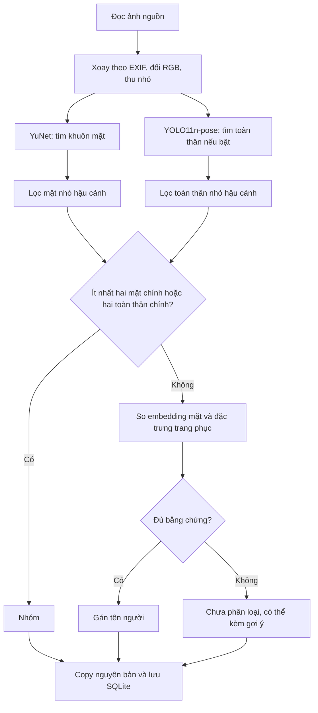

# Thuật toán và công nghệ sử dụng

Tài liệu mô tả phiên bản hiện tại theo mã nguồn trong dự án. Đây là ứng dụng tích hợp các model đã huấn luyện sẵn, kết hợp với thuật toán so khớp và quy tắc phân loại; không tự huấn luyện model nhận diện mới.

## 1. Tổng quan

Tool phân loại ảnh JPG/JPEG/PNG sau buổi chụp, chạy trên máy bằng Python và giao diện Streamlit. Nhận diện khuôn mặt là tín hiệu chính; toàn thân và màu trang phục hỗ trợ trong cùng buổi chụp. Kết quả gồm thư mục theo tên người, `Nhóm`, hoặc `Chưa phân loại`.



Số mặt và số toàn thân được xét riêng, không cộng trực tiếp vì một người có thể được cả hai model phát hiện.

## 2. Thư viện và vai trò

| Công nghệ | Vai trò thực tế |
|---|---|
| Python | Điều phối luồng xử lý, tính điểm, áp dụng quy tắc, quản lý file và trạng thái |
| Streamlit | Web UI local: nhập thư mục, đăng ký người, upload mẫu, thumbnail, tiến độ, sửa kết quả |
| OpenCV (`opencv-python`) | Chạy YuNet/SFace, căn chỉnh mặt, chuyển màu, tạo mặt nạ và histogram |
| NumPy | Vector, chuẩn hóa, tích vô hướng và phép tính điểm trang phục |
| Pillow | Đọc ảnh, sửa hướng EXIF, chuyển RGB và tạo ảnh thu nhỏ |
| Ultralytics, tùy chọn | Chạy YOLO11n-pose để tìm toàn thân và điểm khớp |
| PyTorch, dependency của Ultralytics | Backend thực thi model tư thế `.pt` |
| SQLite (`sqlite3` của Python) | Lưu người, mẫu, vector, kết quả và tiến độ |
| `filelock` | Ngăn nhiều tiến trình cùng thay đổi dữ liệu/xử lý |
| `hashlib`, `pathlib`, `shutil` | Hash nội dung, quản lý đường dẫn và copy file |

Các khoảng phiên bản được khai báo trong [requirements.txt](requirements.txt) và [requirements-appearance.txt](requirements-appearance.txt). Không cần GPU; model tư thế được cấu hình chạy CPU.

## 3. Phát hiện và nhận diện mặt

### Face detection — YuNet

File model: `face_detection_yunet_2023mar.onnx`.

YuNet phát hiện vị trí mặt và các điểm mốc dùng để căn chỉnh. Bước này chỉ trả lời **có mặt ở đâu**, chưa xác định danh tính. Ngưỡng detector trong mã là 0.90.

Trước suy luận, ảnh được xoay đúng EXIF, chuyển RGB, thu nhỏ cạnh dài tối đa 1800 px, rồi chuyển sang BGR cho OpenCV. Bản ảnh xuất vẫn là file gốc được copy, không phải ảnh đã thu nhỏ.

Lọc mặt chính bằng diện tích bounding box. Với mặc định, mặt phải đồng thời đạt:

- Ít nhất 20% diện tích mặt lớn nhất trong ảnh.
- Ít nhất 0.1% diện tích ảnh.

Đây là heuristic dựa vào kích thước, không xác định được ý đồ chụp hay chắc chắn phân biệt người mẫu với người đi đường.

### Face embedding — SFace

File model: `face_recognition_sface_2021dec.onnx`.

SFace nhận khuôn mặt đã căn chỉnh qua `alignCrop`, tạo vector đặc trưng qua `feature`, sau đó vector được chuẩn hóa L2:

```text
v_normalized = v / ||v||₂
```

Ảnh mẫu được chấp nhận khi có đúng một mặt, chiều nhỏ nhất của mặt ít nhất 60 px sau thu nhỏ. Khi phân loại, mặt cần chiều nhỏ nhất ít nhất 40 px để được tạo vector so khớp.

Đăng ký người là **lưu embedding của mẫu**, không phải huấn luyện hoặc fine-tune SFace. Vector và bản sao ảnh mẫu được lưu local. Vector của ảnh đang phân loại được tính để so khớp; hiện không lưu vào bảng mẫu.

### Face comparison — cosine similarity

Hai vector đã chuẩn hóa được so bằng tích vô hướng:

```text
cosine(a, b) = a · b
score(person) = max(cosine(query, sample) với các mẫu của người đó)
```

Người có điểm cao nhất chỉ được gán khi:

```text
điểm cao nhất ≥ ngưỡng mặt                         (mặc định 0.50)
điểm cao nhất − điểm người thứ hai ≥ cách biệt    (mặc định 0.10)
```

Nếu chỉ đăng ký một người, chỉ kiểm tra ngưỡng điểm, không có đối thủ để kiểm tra cách biệt. Cosine không phải xác suất nhận đúng; ngưỡng cần được kiểm chứng trên dữ liệu thực tế.

## 4. Phát hiện toàn thân và tư thế

Model tùy chọn: **YOLO11n-pose**, file `yolo11n-pose.pt`.

Model trả về hộp toàn thân và 17 điểm khớp cơ thể. Tool dùng vai, hông, gối để định vị vùng trang phục; không so hình thể, dáng đi hay tư thế để xác định danh tính.

Cấu hình suy luận: CPU, `imgsz=640`. Các mặc định có thể chỉnh trong UI:

| Tham số | Mặc định | Ý nghĩa |
|---|---:|---|
| Độ tin cậy phát hiện toàn thân | 0.55 | Lọc phát hiện yếu của model |
| Diện tích người / người lớn nhất | 0.25 | Loại người quá nhỏ so với chủ thể lớn nhất |
| Diện tích người / ảnh | 0.025 | Diện tích toàn thân tối thiểu bằng 2.5% ảnh |

Có ít nhất hai mặt chính **hoặc** hai toàn thân chính thì phân loại `Nhóm`, kể cả người chưa đăng ký. Nếu chỉ có một mặt chính và một toàn thân chính, tâm mặt phải nằm trong hộp toàn thân và trong 45% phía trên của hộp; nếu không, trả về `Chưa phân loại` vì liên kết chủ thể không rõ.

Đó là phép kiểm tra hình học đơn giản, chưa phải hệ thống tracking hay ghép danh tính nhiều người.

## 5. So khớp trang phục

### Lấy vùng áo/quần

Mẫu trang phục được gán người bằng thao tác của người dùng, lưu riêng theo tên buổi chụp. Ảnh mẫu phải có đúng một người được model tìm thấy.

- Vùng áo: đa giác từ hai vai và hai hông.
- Vùng quần: đa giác từ hai hông và hai gối nếu các điểm gối đủ rõ.
- Độ tin cậy các điểm sử dụng phải ít nhất 0.50.
- Đa giác được co về tâm với hệ số 0.80 để giảm nền quanh mép.
- Vùng lấy màu cần ít nhất 500 pixel; vùng áo không hợp lệ thì không tạo đặc trưng.

Đây không phải segmentation chính xác từng pixel của quần áo; tóc, tay, nền hoặc người khác vẫn có thể lọt vào vùng lấy màu.

### Histogram màu HSV

Mỗi vùng được biểu diễn bằng histogram HSV ba chiều:

```text
12 bin Hue × 4 bin Saturation × 4 bin Value = 192 phần tử
```

Histogram được chuẩn hóa để tổng các phần tử bằng 1. Đặc trưng này mô tả phân bố màu, **không mã hóa vị trí họa tiết hoặc đặc trưng ngữ nghĩa toàn thân như model Re-ID**.

### Hệ số Bhattacharyya

Độ giống hai histogram chuẩn hóa `p`, `q`:

```text
BC(p, q) = Σ sqrt(p[i] × q[i])
```

Điểm cao nghĩa là phân bố màu giống hơn. Cách kết hợp vùng:

```text
Có vùng quần ở cả hai mẫu: similarity = 0.70 × điểm áo + 0.30 × điểm quần
Không có đủ vùng quần:     similarity = điểm áo
```

Điểm của một người là trung bình hai mẫu trang phục giống ảnh đầu vào nhất; nếu chỉ có một mẫu thì dùng mẫu đó để xếp hạng/gợi ý, chưa đủ điều kiện hỗ trợ gán tự động.

## 6. Kết hợp bằng chứng và từ chối gán

Tool áp dụng **quy tắc ngưỡng**, không dùng một model học máy riêng để hợp nhất các điểm.

Sau các kiểm tra nhóm và liên kết mặt/toàn thân:

1. Mặt vượt ngưỡng và cách biệt: gán theo mặt, dù màu quần áo của người khác giống hơn.
2. Mặt chưa đủ chắc: chỉ cho trang phục hỗ trợ nếu cùng người đứng đầu ở cả hai bảng điểm và thỏa tất cả điều kiện bên dưới.
3. Không đủ điều kiện: `Chưa phân loại`. Có thể lưu gợi ý trang phục để người dùng xác nhận.

Điều kiện hỗ trợ bằng trang phục:

| Điều kiện | Công thức hoặc mặc định |
|---|---|
| Điểm mặt tối thiểu | `max(0.40, ngưỡng mặt − 0.08)` |
| Cách biệt mặt, nếu có người thứ hai | `max(0.04, cách biệt mặt / 2)` |
| Số mẫu trang phục của ứng viên | Ít nhất 2 |
| Điểm trang phục | Ít nhất 0.88, chỉnh được |
| Cách biệt trang phục, nếu có người thứ hai | Ít nhất 0.12, chỉnh được |
| Ngưỡng hiện gợi ý trang phục | 0.75, chỉnh được |

**Không có mặt hoặc mặt quá nhỏ thì không tự gán danh tính chỉ bằng quần áo.** Ngưỡng gợi ý chỉ quyết định có hiện tên gợi ý hay không; không biến gợi ý thành kết quả. Hiện gợi ý chỉ kiểm tra điểm cao nhất, không yêu cầu cách biệt với người thứ hai, nên vẫn cần người dùng duyệt.

Ví dụ: ảnh quay lưng có điểm trang phục 0.6122. Đặt ngưỡng gợi ý 0.60 sẽ cho phép hiện gợi ý, nhưng ảnh vẫn ở `Chưa phân loại` cho đến khi được gán tay.

## 7. Lưu trữ và chạy tiếp

SQLite lưu các bảng chính:

| Bảng | Dữ liệu |
|---|---|
| `people` | Tên người đăng ký |
| `samples` | Đường dẫn bản sao ảnh mẫu mặt, embedding dạng JSON và hash |
| `outfits` | Tên buổi, người, đường dẫn mẫu trang phục, histogram dạng JSON và hash |
| `photos` | Nguồn/đích, hash, nhãn, lý do, chi tiết điểm, trạng thái copy, cờ sửa tay |

SHA-256 kiểm tra nội dung file. Định danh xử lý kết hợp thư mục nguồn, thư mục đích, đường dẫn ảnh và hash nội dung. Ảnh hoàn thành có bản copy còn đúng hash được bỏ qua ở lượt sau; vẫn cần đọc file để kiểm tra hash.

Dấu vân tay cấu hình gồm mẫu, ngưỡng và buổi chụp. Tùy chọn thử lại chỉ đánh giá lại ảnh tự động `Chưa phân loại` khi cấu hình khác lần đã lưu, tránh lặp cùng ảnh qua các lượt. Kết quả sửa tay được giữ khi bản copy còn hợp lệ.

Copy dùng tạo file độc quyền, thêm UUID khi trùng tên. Ý định copy được ghi vào SQLite trước khi ghi file để có thể phục hồi. Gán lại tạo bản copy mới trước, chỉ xóa bản kết quả cũ nếu nội dung vẫn đúng hash. Nguồn không bị sửa.

Xóa người loại tên và toàn bộ mẫu của họ khỏi nhận diện; lịch sử và ảnh kết quả vẫn được giữ. `filelock` ngăn các thao tác thay đổi dữ liệu chạy đồng thời.

## 8. Python làm gì, model làm gì?

Model đã học các trọng số từ trước và thực hiện tìm mặt, tạo embedding hoặc tìm điểm khớp. OpenCV/Ultralytics/PyTorch cung cấp công cụ chạy model.

Code Python trong dự án thực hiện tiền xử lý **và** toàn bộ logic ứng dụng: đăng ký mẫu, tính điểm, lọc chủ thể, hợp nhất bằng chứng, từ chối gán mơ hồ, lưu dữ liệu, copy file và giao diện. Vì vậy Python không chỉ là bước tiền xử lý, nhưng dự án cũng không tuyên bố tự phát triển hoặc tự huấn luyện các model nền.

| File | Nội dung |
|---|---|
| [app.py](app.py) | UI và điều phối xử lý |
| [photo_sorter/vision.py](photo_sorter/vision.py) | YuNet/SFace, đọc ảnh và luồng phân loại |
| [photo_sorter/appearance.py](photo_sorter/appearance.py) | YOLO pose và đặc trưng màu trang phục |
| [photo_sorter/policy.py](photo_sorter/policy.py) | Quy tắc ngưỡng, lọc chủ thể, quyết định danh tính |
| [photo_sorter/storage.py](photo_sorter/storage.py) | SQLite, mẫu, hash, copy và phục hồi |
| [download_models.py](download_models.py) | Tải model mặt |
| [download_appearance.py](download_appearance.py) | Tải model tư thế |

## 9. Phạm vi và giới hạn

- Chưa có **Person Re-identification**, nhận dạng dáng đi, face tracking hoặc huấn luyện lại trên ảnh người dùng.
- Trang phục hiện chỉ so màu; thay ánh sáng, người mặc giống nhau, vật che hoặc nền lọt vào vùng màu đều ảnh hưởng kết quả.
- Bộ lọc hậu cảnh dựa vào diện tích, có thể bỏ sót người chính đứng xa hoặc tính nhầm người đi đường đứng gần.
- Điểm model/cosine/histogram không phải xác suất đúng đã được hiệu chuẩn.
- Chưa có benchmark độ chính xác trên bộ ảnh thực tế của người dùng. Kiểm thử logic không thay thế đánh giá chất lượng model.
- Ảnh, mẫu và embedding xử lý local. Cài thư viện/tải model cần mạng; sau khi có đủ model thì suy luận offline. Cấu hình tắt telemetry Streamlit, tắt đồng bộ Ultralytics và không tự tải model lúc suy luận.

Tham khảo [README.md](README.md) để cài đặt, chạy Windows, chỉnh ngưỡng và xem các giới hạn kiểm thử. Model/thư viện bên thứ ba có giấy phép riêng; thông tin nguồn model được liệt kê trong README.
